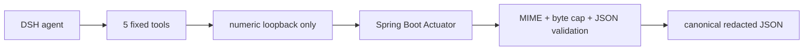

# dsh-spring-inspector — bounded Spring Boot diagnostics for DeepSeek Harness

> [!IMPORTANT]
> **Unofficial community plugin.** Independently maintained and not affiliated
> with or endorsed by DeepSeek. Review the source and assess risks before use.

Ask DeepSeek Harness why a local Spring Boot app is unhealthy, which routes,
beans, or conditions are active, and what a JVM metric reports—without giving
the model arbitrary HTTP access. The plugin exposes five bounded, read-only
tools:

- `spring_health`
- `spring_route_search`
- `spring_bean_search`
- `spring_condition_report`
- `spring_metric_read`

It is intentionally not a generic HTTP client. The model chooses a configured
target id and structured filters; it can never supply a URL, HTTP method,
header, or arbitrary Actuator path.

[中文说明](README.zh-CN.md)

```text
You: Use spring_health on target orders.
Tool: { "statusCode": 503, "status": "DOWN", "redactedCount": 1, ... }
```

## Why this plugin

Raw Actuator documents can be large and can contain sensitive fields. This
plugin projects them into bounded canonical JSON, redacts sensitive keys before
the value reaches Native or Code Mode, and reports redaction and source
truncation. Health output contains only a bounded status/component-status tree;
arbitrary health details are never returned.



## Install

Requires Node.js `^22.19.0 || >=24.0.0`. The current release is tested with
DeepSeek Harness `0.1.0-rc.6`.

Install the pinned GitHub release into a DSH profile:

```sh
dsh plugin --profile spring add github:po-et/dsh-spring-inspector#v0.1.0
dsh --profile spring --dump-config
```

The repository commits its compiled `lib/` artifacts and has no `prepare`
script, so a GitHub install does not require pnpm `allowBuilds` permission.

For local development:

```sh
git clone https://github.com/po-et/dsh-spring-inspector.git
cd dsh-spring-inspector
pnpm install
pnpm check
dsh plugin --profile spring add .
```

## Configure Spring Boot safely

Spring Boot exposes only `health` over HTTP by default. Expose the exact
read-only endpoints needed by this plugin, preferably on a separate loopback
management port:

```properties
management.server.address=127.0.0.1
management.server.port=8081
management.endpoints.web.exposure.include=health,mappings,beans,conditions,metrics
management.endpoint.health.show-components=when_authorized
management.endpoint.health.show-details=never
```

Do not use `include=*`, and do not remove Spring Security merely to make the
plugin work. See Spring's official [Actuator endpoints](https://docs.spring.io/spring-boot/reference/actuator/endpoints.html)
and [monitoring over HTTP](https://docs.spring.io/spring-boot/reference/actuator/monitoring.html)
guidance.

## Configure the DSH target

The bundle defaults to `http://127.0.0.1:8080/actuator`. Override its row in
`$DSH_HOME/profiles/spring/cordis.patch.yml`:

```yaml
- id: spring-inspector
  config:
    targets:
      - id: orders
        actuatorUrl: http://127.0.0.1:8081/actuator
        authorizationRef: SPRING_ACTUATOR_AUTHORIZATION
    timeoutMs: 5000
    maxResponseBytes: 262144
    defaultLimit: 25
    maxLimit: 100
```

`authorizationRef` is a credential reference, not a secret. Its resolved value
must be the complete `Authorization` header, such as `Bearer ...` or
`Basic ...`. DSH resolves it for every operation, so rotation takes effect on
the next call. When a target uses `authorizationRef`, the optional DSH
credentials service must be available at call time. One simple local option is
to set the referenced environment variable before starting DSH.

Multiple targets are supported, but every target must resolve syntactically to
`127.0.0.1`, `[::1]`, or exact `localhost`; `localhost` is rewritten to
`127.0.0.1` before any request.

## Example prompts

```text
Use spring_health on target orders.
Find POST order routes on target orders with spring_route_search.
Show negative Redis conditions on target orders.
Read jvm.memory.used for target orders with tag area:heap.
```

## Security boundary

- HTTP loopback only; no DNS, private-network ranges, metadata IPs, or remote hosts.
- Fixed `GET` endpoints; no generic Actuator fetch tool.
- Every redirect is rejected.
- One-shot Node HTTP agent (`agent: false`); no process-global proxy/agent path.
- `Accept-Encoding: identity`, JSON/`+json` only, fatal UTF-8 decoding.
- Declared and streamed byte caps; oversized JSON is rejected, never truncated and parsed.
- Caller cancellation plus a local total deadline.
- Canonical-value redaction, including descriptor-shaped secrets, arrays, and
  nested objects, with a global node budget and visible source-truncation flag.
- Health projection drops arbitrary details and returns at most 200 component
  statuses across six levels.
- Compact model rendering has an independent 256 KiB text budget.
- `env`, `configprops`, `heapdump`, `threaddump`, `loggers`, `shutdown`, and
  `httpexchanges` are not implemented.

Read the complete [threat model and architecture](docs/architecture.md) and
the [upstream contribution analysis](docs/upstream-analysis.md), and report
vulnerabilities according to [SECURITY.md](SECURITY.md).

## Compatibility note

DeepSeek Harness is a developer preview. The plugin uses raw JSON-Schema tool
registration with explicit argument guards and type-only DSH service imports.
The built JavaScript has no runtime import of `@deepseek-ai/dsh-tools` or
`@deepseek-ai/dsh-credentials`, avoiding a second service-definition instance
in the profile. CI verifies this property on Node 22, 24, and 26.

## Development

```sh
pnpm install
pnpm typecheck
pnpm test
pnpm build
pnpm check:dist
pnpm pack
pnpm test:dsh:rc6
```

The test suite covers URL/SSRF policy, path containment, raw argument guards,
real loopback HTTP, redirects, status 503 health, MIME, response caps,
cancellation, redaction, and Actuator projections.
The rc.6 smoke command installs the packed tarball into an isolated profile,
checks peer dependencies, boots the real Loader, executes all five Spring tools
through `ctx.tools.execute()`, and verifies canonical redaction plus invalid
argument rejection. It prints and retains the temporary profile for inspection.

## License

[MIT](LICENSE)
